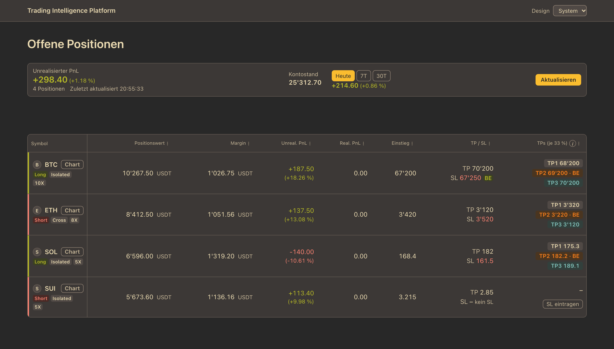

# Trading Intelligence Platform

Persönliches Trading-Journal mit automatischem Import von **BingX** (USDT-M Futures).
Alles läuft lokal auf deinem Mac: Deine Daten bleiben bei dir, es gibt keine Cloud und kein Konto.




*Screenshots mit erfundenen Daten.*

## Was die App kann

- Offene Positionen live von BingX, mit Kontostand sowie PnL für Heute, 7 Tage und 30 Tage
- Stop-Loss, Take-Profit und Break-even je Position, dazu CRV-Ziele (1R, 2R, 3R)
- Chart je Position mit Einstieg, Stop-Loss und R-Linien
- Automatischer Import der geschlossenen Positionen alle 5 Minuten
- Hell, dunkel oder wie das System

## Installation (macOS, mit Homebrew)

Voraussetzung ist [Homebrew](https://brew.sh).

```bash
brew install monkey-trader/tap/tip-server          # der Dienst: Import, Datenbank, Web-UI
brew install --cask monkey-trader/tap/tip-app      # optional: die Mac-App (Fenster auf den Dienst)
```

Die Mac-App ist nur ein Fenster. Die Daten holt und speichert der Dienst `tip-server`, deshalb brauchst du ihn immer.
Wer keine App will, nutzt das UI im Browser.

### 1. BingX-API-Key anlegen (nur Lese-Rechte)

Die App braucht einen API-Key, um deine Positionen und Einkommens-Buchungen zu lesen.
Sie handelt nie und kann kein Geld bewegen.

1. In BingX einloggen (Web oder App) und das Profil-Menü öffnen, dann **API-Verwaltung** (*API Management*).
2. **API erstellen** wählen und einen Namen vergeben, z.B. `tip-journal`.
3. Bei den Berechtigungen **nur „Lesen“ (Read)** aktivieren. **Handeln, Auszahlen und Transfer bleiben aus.**
4. Optional, aber empfohlen: die IP-Adresse deines Macs freigeben (IP-Beschränkung).
5. Bestätigen (2FA). BingX zeigt dir **API Key** und **Secret Key**. Den Secret Key siehst du **nur einmal**, kopiere ihn sofort.

> Die Menünamen bei BingX können sich leicht ändern. Wichtig ist nur: ein neuer Key, nur Lese-Recht.

### 2. Key hinterlegen und starten

Die Keys kommen in eine Datei in deinem Home-Ordner, die nur du lesen kannst (nie in ein Repo oder einen Chat):

```bash
mkdir -p ~/.config/tip && chmod 700 ~/.config/tip
printf 'BX_KEY=dein-api-key\nBX_SECRET=dein-secret-key\n' > ~/.config/tip/env
chmod 600 ~/.config/tip/env
brew services start tip-server
```

Ersetze `dein-api-key` und `dein-secret-key` durch deine Werte.
`brew services` startet den Dienst im Hintergrund und nach jedem Neustart des Macs automatisch wieder.

### 3. Öffnen

- **Mac-App:** „Trading Intelligence Platform“ aus dem Programme-Ordner oder per Spotlight starten.
  Sie ist nur ad-hoc signiert; Homebrew hebt die Gatekeeper-Sperre auf. Warnt macOS trotzdem, öffnest du sie einmal per Rechtsklick → **Öffnen**.
- **Browser:** **http://127.0.0.1:3000**

Beide zeigen dasselbe UI. Die App spricht intern mit dem lokalen Dienst, du musst die Adresse nicht eingeben.

Der erste Import beginnt mit dem ersten Start. Geschlossene Positionen erscheinen, sobald BingX sie liefert.

## Alltag

| Was | Befehl |
|---|---|
| Aktualisieren | `brew upgrade tip-server tip-app && brew services restart tip-server` |
| Stoppen | `brew services stop tip-server` |
| Status prüfen | `curl http://127.0.0.1:3000/health` (Antwort: `{"status":"ok"}`) |
| Log ansehen | `tail -f $(brew --prefix)/var/log/tip-server.log` |
| Deinstallieren | `brew services stop tip-server && brew uninstall tip-server && brew uninstall --cask tip-app` |

Deine Daten (SQLite) liegen unter `~/Library/Application Support/tip/journal.db`.
Das Löschen dieser Datei setzt das Journal zurück (auch deine Notizen und Stop-Loss-Eingaben).

### Hilfe bei Problemen

- **App zeigt „Server nicht erreichbar“:** Der Dienst läuft nicht. `brew services start tip-server` im Terminal.
- **Seite lädt nicht:** `brew services list` zeigt, ob `tip-server` läuft. Sonst `brew services restart tip-server`.
- **Keine Positionen / Fehler 503 „not-configured“:** Die Keys fehlen oder sind falsch. Prüfe `~/.config/tip/env` und starte neu.
- **Fehler von BingX (502/504):** Meist vorübergehend oder ein Limit bei zu vielen Abfragen, kurz warten.
- **Port 3000 ist belegt:** Ein anderes Programm nutzt ihn. Mit `lsof -nP -iTCP:3000 -sTCP:LISTEN` findest du es.

## Sicherheit

- Der API-Key hat **nur Lese-Rechte**. Die App macht nur lesende Anfragen an BingX.
- Die Keys stehen nur in `~/.config/tip/env` (Rechte 600), nie im Code, und die App gibt sie nie über ihre API aus.
- Der Dienst lauscht **nur auf deinem Mac** (`127.0.0.1`) und hat keine Anmeldung. Auch die Mac-App nutzt nur diesen lokalen Dienst. Gib den Port nicht ins Netz frei.

## Für Entwickler

Technische Doku liegt unter [`docs/`](docs/):

- [`docs/entwicklung.md`](docs/entwicklung.md): aus dem Quellcode starten, Tests, Prüfungen
- [`CLAUDE.md`](CLAUDE.md): Architektur (Onion/DDD, API-first), Regeln und Ablauf
- [`docs/openapi.yaml`](docs/openapi.yaml): API-Vertrag
- [`backend/README.md`](backend/README.md): Go-Backend
- [`docs/ai-blueprint.md`](docs/ai-blueprint.md): Entwickeln mit AI-Agenten
