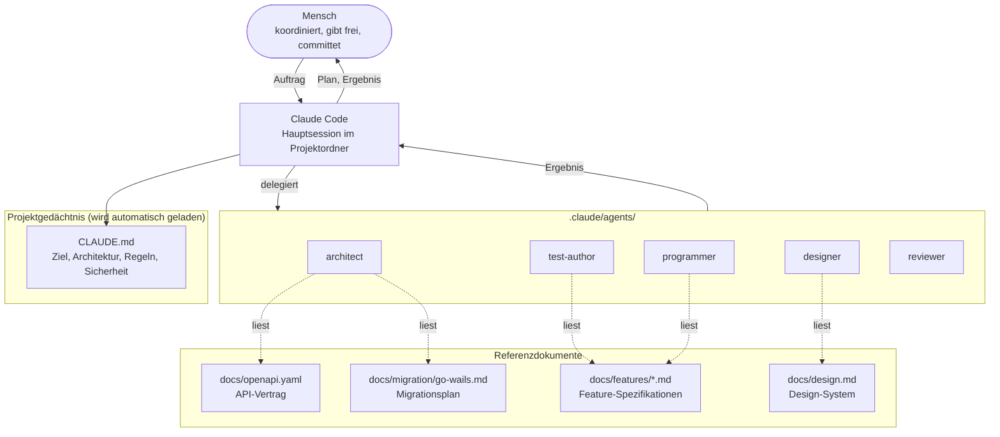
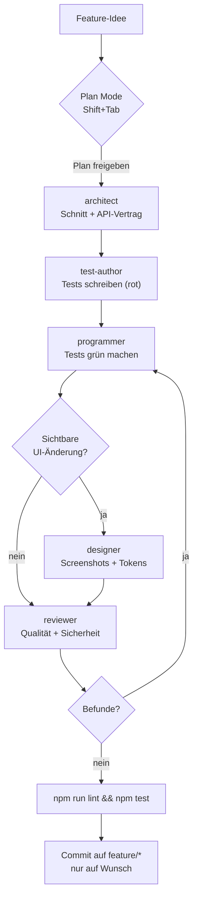
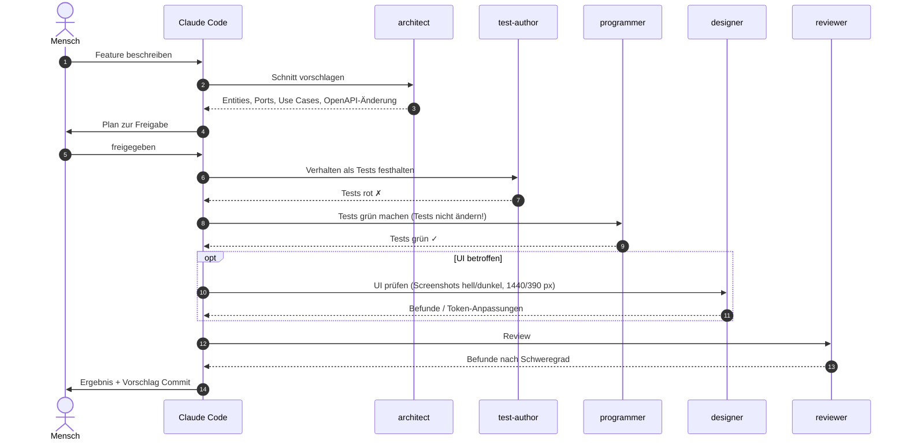
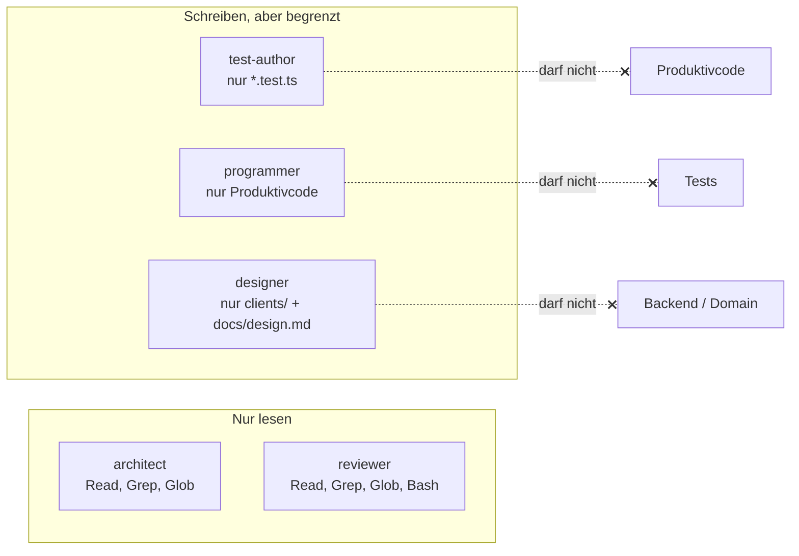
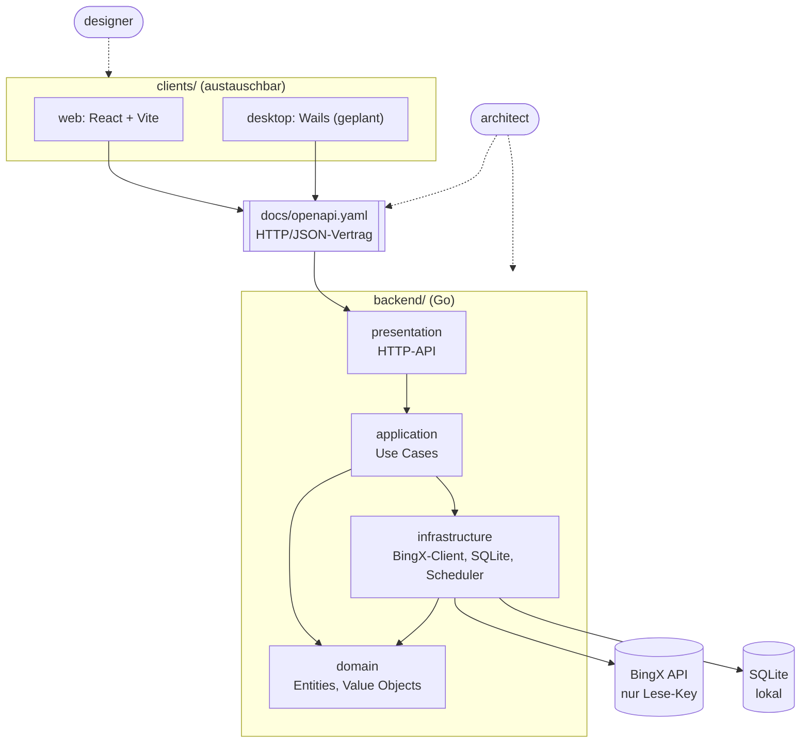

# AI-Setup: Entwickeln mit Claude Code und Subagents

Wie dieses Projekt mit AI-Agenten entwickelt wird. Die Diagramme sind Mermaid
und werden auf GitHub und in den meisten Editoren direkt gerendert.

## 1. Überblick: Wer liest was?



## 2. Ablauf pro Feature



## 3. TDD im Detail: Wer darf was ändern?



## 4. Rechte der Rollen



| Rolle | Darf schreiben | Prüft vor allem |
|---|---|---|
| architect | nein | Abhängigkeiten zeigen nach innen, API passt zur `openapi.yaml` |
| test-author | nur Tests | Verhalten, Randfälle, echte BingX-Fixtures |
| programmer | nur Code | einfachster Code, der die Tests erfüllt |
| designer | nur `clients/` | Tokens, Kontrast, Konsistenz, per Screenshot |
| reviewer | nein | Secrets, Fehlerbehandlung, Lesbarkeit |

## 5. Wo die Agenten im System arbeiten



## 6. Dateien des Setups

```
CLAUDE.md                     Projektgedächtnis (immer geladen)
.claude/agents/
├── architect.md
├── test-author.md
├── programmer.md
├── designer.md
└── reviewer.md
docs/
├── ai-setup.md               dieses Dokument
├── local-ai-setup.md         Ollama + Qdrant + repo-rag
├── design.md                 Design-System (designer)
├── openapi.yaml              API-Vertrag (architect)
├── features/                 Feature-Spezifikationen
└── migration/                Migrationsplan Go + Wails
```

## 7. Übertragbar auf andere Projekte

Übertragbar sind die **Prinzipien**: ein zentrales Projektgedächtnis, getrennte Rollen mit
minimalen Rechten, Tests als Vertrag, den der Programmierer nicht ändern darf, ein unabhängiges
Review, und der Mensch koordiniert.

Claude-Code-spezifisch sind nur die Dateinamen und Formate (`CLAUDE.md`, `.claude/agents/`).

## 8. Lokales Setup zum Token-Sparen

Ollama, Qdrant, `repo-rag` und `ask-local` entlasten Claude bei Suche und Fleissarbeit.
Architektur-Grafik, Installation und TODOs: [local-ai-setup.md](local-ai-setup.md).
