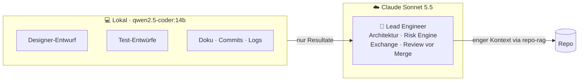

# Lokales AI-Setup: Ollama + Qdrant + Claude Code

Hybrid-Setup, um Claude-Tokens zu sparen: Fleissarbeit lokal, Denkarbeit bei Claude.

### Architektur (Stand 17.10.2026)


> **Stand 18.10.2026:** Alle 5 Subagenten laufen auf Claude (architect/designer: Haiku, Rest: Sonnet), mit Token-Regeln
> in `CLAUDE.md` und `.claude/agents/`. Ergebnis: ≈ +1 % Wochen-Limit pro Phase statt +3 % (siehe „Messwerte“ unten).

### Ziel-Bild



Rechner: MacBook Air M2, 24 GB RAM

---

## ✅ TODO

- [x] Git-Hook-Vorlage und Repo-Setup: `git ai-init` (siehe „Neues Repo einrichten“)
- [x] `.claude/agents/` optimiert (Token-Regeln, Modellwahl, Tests nie aufweichen)
<<<<<<< Updated upstream
- [ ] Ollama-Autostart prüfen: `brew services list` oder Ollama.app unter Anmeldeobjekte
- [ ] Docker Desktop: „Start when you sign in“ aktivieren
=======
- [x] Ollama-Autostart: läuft als `brew services` (startet bei Login)
- [x] Docker Desktop: „Start when you sign in“ aktiv (Qdrant startet mit, `--restart unless-stopped`)
>>>>>>> Stashed changes
- [ ] Optional: `mxbai-embed-large` testen, falls die Suche ungenau ist
- [ ] Optional: `--code`-Schalter in `repo-rag`, um Markdown-Treffer auszublenden

---

## Komponenten

| Teil | Wo | Zweck |
|---|---|---|
| Ollama | `localhost:11434` | lokale Modelle |
| `qwen2.5-coder:14b` | Ollama | Code-Modell für `ask-local` |
| `nomic-embed-text` | Ollama | Embeddings für Qdrant |
| Qdrant | Docker, `localhost:6333` | Vector-DB, Dashboard: http://localhost:6333/dashboard |
| `ask-local` | `~/.dotfiles/bin/ask-local` | Frage/Pipe an das lokale Modell (deepseek-coder-v2:16b, `--deep` = qwen2.5-coder:14b) |
| `repo-rag` | `~/.dotfiles/bin/repo-rag` | Repo indexieren und semantisch suchen |
| `bench-local` | `~/.dotfiles/bin/bench-local` | lokale Modelle mit Repo-Aufgaben messen |
| Index-Status | `~/.cache/repo-rag/<collection>.json` | welche Dateien indexiert sind |

---

## Erstinstallation (neuer Mac)

```bash
# 1. Ollama (als Hintergrunddienst)
brew install ollama
brew services start ollama
ollama pull qwen2.5-coder:14b     # für ask-local --deep
ollama pull deepseek-coder-v2:16b # Standard für ask-local (MoE, ~40 tok/s)
ollama pull nomic-embed-text

# 2. Qdrant (startet mit Docker automatisch neu)
docker run -d --name qdrant --restart unless-stopped \
  -p 6333:6333 -p 6334:6334 \
  -v ~/qdrant_storage:/qdrant/storage qdrant/qdrant

# 3. Scripts: liegen im Dotfiles-Repo (github.com/c3smonkey/.dotfiles, Ordner bin/),
#    ~/.dotfiles/bin ist über die .zshrc bereits im PATH

# 4. Git-Hook-Vorlage (einmalig, gilt für alle neuen Klone)
mkdir -p ~/.git-template/hooks
printf '#!/bin/sh\n(repo-rag index >/dev/null 2>&1 &)\n' > ~/.git-template/hooks/post-commit
chmod +x ~/.git-template/hooks/post-commit
git config --global init.templateDir ~/.git-template
```

---

## Neues Repo einrichten

```bash
cd <repo>
git ai-init --claude
```

`git ai-init` (in `~/.dotfiles/bin`) richtet einmalig die globale Hook-Vorlage ein (`~/.dotfiles/git-template`,
`init.templateDir`), installiert im Repo den post-commit-Hook (überschreibt keinen fremden), prüft Ollama/Qdrant/Modelle
und startet die erste Indexierung. Mit `--claude` ergänzt es zusätzlich diesen Abschnitt in der `CLAUDE.md`:

```markdown
## Code finden (repo-rag)
Bevor du Ordner durchsuchst oder Dateien breit liest:
`repo-rag search --files-only "<konkrete englische Frage mit Code-Begriffen>"`
Lies danach nur die gefundenen Dateien/Zeilen. Optional `--path backend-go` zum Eingrenzen.
Nach grösseren Änderungen: `repo-rag index`.

## Token-Sparen: lokales Modell
- Logs: `tail -n 500 <log> | ask-local "Fasse Fehler zusammen"`
- Grosse Dateien: `ask-local -f <datei> "Liste Funktionen mit Zweck"`
- Commits: `git diff --staged | ask-local "Conventional-Commit-Message"`
Nicht delegieren: Architektur, Strategielogik, Risk Engine, Exchange-Integration, Reviews.
```

---

## Täglicher Gebrauch

```bash
# Suchen (Begriffe verwenden, die im Code vorkommen)
repo-rag search --files-only "fetch open positions from bingx api"
repo-rag search -k 5 --path backend-go "risk limit"
repo-rag stats

# Lokales Modell
ask-local "Regex für ISO-Datum"
git log --oneline -20 | ask-local --fast "In 1 Satz zusammenfassen"
git diff --staged | ask-local "Commit-Message"
ask-local -f datei.go "Erklär in 5 Punkten"
```

Der Index aktualisiert sich nach jedem Commit automatisch (post-commit-Hook).

---

## Prüfen, ob alles läuft

```bash
curl -s localhost:11434            # → Ollama is running
docker ps | grep qdrant            # → Up …
ollama list | grep -E "qwen|nomic" # → beide Modelle da
repo-rag stats                     # → Punkte > 0
ls -l ~/.cache/repo-rag/           # Zeitstempel = letzter Commit
```

---

## Fehlerbehebung

| Meldung | Lösung |
|---|---|
| `ask-local: Ollama-Fehler 404: model … not found` | `ollama pull qwen2.5-coder:14b` |
| `… nicht erreichbar … Läuft der Server?` | `brew services start ollama` |
| `repo-rag: localhost:6333 nicht erreichbar` | Docker Desktop starten, `docker start qdrant` |
| `Collection … existiert nicht` | `repo-rag index` |
| Suche liefert nur Docs/unpassende Treffer | Code-Begriffe verwenden, `--path` setzen |
| Index komplett neu | `repo-rag index --full` |

---

## Erkenntnisse

- Die lokalen Ergebnisse sind Entwürfe. Das 14b-Modell hat zum Beispiel eine falsche IBAN-Regex geliefert, darum Präzises immer selbst prüfen.
- Für die Suche zählen Begriffe, die im Code vorkommen, mehr als die Sprache (Deutsch oder Englisch).
- Claude Code (Sonnet 5.5) nutzt `repo-rag` von selbst, sobald es in der `CLAUDE.md` steht. Das wurde am 17.10.2026 bestätigt.
- Auf dem Air nicht mehrere lokale Agenten parallel laufen lassen.
- `ask-local` hält das Modell 30 min geladen (warm ≈ 2× schneller), wählt den Kontext automatisch und warnt, wenn eine Eingabe gekürzt wird.
- `ask-local` nur für EINE Quelle. Status-Fragen wie „Plan vs. Commits“ beantwortet das 14b-Modell falsch, Claude macht das günstig selbst.
- Gemessen: 7b warm ≈ 11 s für ~150 Wörter Antwort, 100 % GPU (prüfen mit `ollama ps`).

---

## Messwerte & Lehren (17.10.2026, Go-Phase 2b)

Referenz: Phase 2b (≈ 2100 Zeilen, architect → test-author → programmer → reviewer), Claude Pro.

| | Wert |
|---|---|
| Wochen-Limit | +3 % (7 % → 10 %) |
| Session-Limit (5-h-Fenster) | +24 % (5 % → 29 %) |
| Kosten-Äquivalent | $5.55 (Haiku $2.93, Sonnet $2.63) |
| Dauer | 45 min, Cache-Trefferquote 97 % |

**Lehren:**
- **Haiku war insgesamt teurer als Sonnet.** Der fortgesetzte (resumed) test-author hatte 179k Kontext und
  18.5 Mio. Cache-Reads. Dazu kam Nacharbeit, weil er Tests aufgeweicht und Produktivcode geschrieben hat.
  → test-author wieder auf `sonnet`, Regel „Tests nie aufweichen“.
- **Agenten neu starten statt resumen.** Ein Resume schleppt den ganzen Verlauf mit, und jeder Schritt liest ihn erneut.
- **Reviewer muss neue Dateien vollständig lesen.** Die Regel „nur Diff“ machte ihn zu oberflächlich (29 s, Mapper übersehen).
- **Günstig entwerfen, teuer prüfen funktioniert**, solange der Prüfer (Sonnet-Lead/reviewer) gründlich ist.
- Faustregel: ~3 % Wochen-Limit pro Phase, ~3–4 solcher Phasen pro 5-h-Session-Fenster.

**Aktuelle Modellwahl der Agenten:**

| Agent | Modell |
|---|---|
| architect | haiku |
| designer | haiku |
| test-author | sonnet |
| programmer | sonnet |
| reviewer | sonnet |

### Vergleich nach den neuen Regeln (17./18.10.2026)

| Phase | Regeln | Woche | Kosten-Äquivalent | Dauer | Nacharbeit |
|---|---|---|---|---|---|
| 2b | alt (Haiku-test-author, Resume, mehrere Runden) | +3 % (+1 % Nachzieher) | $5.55 | 45 min + Nachzieher | Tests aufgeweicht, 2 Review-Runden |
| 2c | neu | +1 % | $1.41 | 16 min | keine |
| 2d | neu + lokaler Lint | +1 % | $1.67 | 17 min | keine; reviewer fand echten Paging-Bug |

**Ergebnis:** etwa 3–4× günstiger pro Phase, bei besserer Qualität.

**Was den Unterschied gemacht hat** (Regeln in `CLAUDE.md`, Abschnitt „Agenten-Orchestrierung“):
- Agenten neu starten statt resumen, kurze Übergabe, Bericht ≤ 15 Zeilen
- test-author und programmer je eine Runde, reviewer genau einmal am Ende
- test-author auf Sonnet + „Tests nie aufweichen“
- `golangci-lint` lokal vor jedem Commit (Version built with go1.27, via `go install`)
- `/clear` nach jedem Commit, Stand in `docs/migration/go-wails.md` → „Aktueller Stand“

**Lehre aus der CI:** Lint, das „erst in der CI“ läuft, sammelt Fehler über mehrere Phasen an (PR #2 war rot). Seit dem lokalen Lint ist das behoben.

### Benchmark lokale Modelle (18.10.2026, `bench-local`, M2 24 GB)

| Modell | Tempo | Verlauf zusammenfassen | Fixture-Felder herauslesen |
|---|---|---|---|
| qwen2.5-coder:7b | ~17 tok/s | ❌ älteste statt neueste Commits | ✅ alle Typen korrekt |
| qwen2.5-coder:14b | ~8 tok/s | ✅ richtig gewichtet | ⚠️ 1 Typfehler |
| mistral | ~9 tok/s | ❌ | ❌ 4 Fehler |
| deepseek-coder-v2:16b (MoE) | **~40 tok/s** | ❌ älteste statt neueste | ✅ korrekt (etwas ausschweifend) |
| gpt-oss:20b (MoE, denkt mit) | ~15 tok/s, bis 85 s | ❌ | ✅ |

→ `ask-local` nutzt standardmässig **deepseek-coder-v2:16b** (2× schneller als das 7b, gleich genau), `--deep` das **qwen2.5-coder:14b** (Verständnis/Gewichtung). Mistral, gpt-oss, qwen 7b entfernt.
→ Qwen 3.6/3.8 (Okt. 2026): das MoE `qwen3.6:35b` braucht ~21–22 GB und passt nicht neben macOS/Docker auf 24 GB; die 27B-Varianten sind dicht und langsam.
