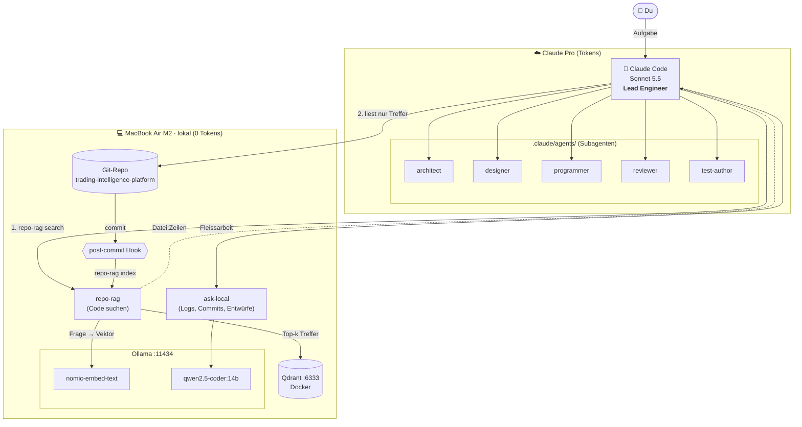
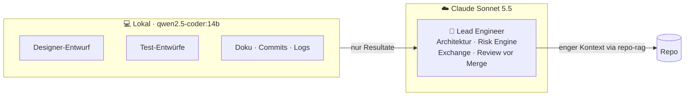

# Lokales AI-Setup: Ollama + Qdrant + Claude Code

Hybrid-Setup, um Claude-Tokens zu sparen: Fleissarbeit lokal, Denkarbeit bei Claude.

### Architektur (Stand 17.10.2026)



> **Aktuell:** Alle 5 Subagenten laufen noch auf Claude und verbrauchen Tokens (programmer ≈ 110k, designer ≈ 71k).
> **Ziel:** Subagenten nutzen ebenfalls `repo-rag` und `ask-local`, und Routineteile wandern ins lokale Modell.

### Ziel-Bild



Rechner: MacBook Air M2, 24 GB RAM

---

## ✅ TODO

- [ ] **Git-Hook-Vorlage global einrichten**, damit jeder neue Klon `repo-rag` automatisch nutzt (siehe „Neues Repo einrichten“)
- [ ] In bestehenden Repos `git init` ausführen, damit der Hook dort auch ankommt
- [ ] `.claude/agents/` optimieren (programmer.md ≈ 110k Tokens, designer.md ≈ 71k), damit sie `repo-rag` und `ask-local` nutzen
- [ ] Ollama-Autostart prüfen: `brew services list` oder Ollama.app unter Anmeldeobjekte
- [ ] Docker Desktop: „Start when you sign in“ aktivieren
- [ ] Optional: `mxbai-embed-large` testen, falls die Suche ungenau ist
- [ ] Optional: `--code`-Schalter in `repo-rag`, um Markdown-Treffer auszublenden

---

## Komponenten

| Teil | Wo | Zweck |
|---|---|---|
| Ollama | `localhost:11434` | lokale Modelle |
| `qwen2.5-coder:14b` | Ollama | Code-Modell für `ask-local` |
| `nomic-embed-text` | Ollama | Embeddings für Qdrant |
| Qdrant | Docker, `localhost:6333` | Vector-DB, Dashboard: http://localhost:6333/dashboard |
| `ask-local` | `~/bin/ask-local` | Frage/Pipe an das lokale Modell |
| `repo-rag` | `~/bin/repo-rag` | Repo indexieren und semantisch suchen |
| Index-Status | `~/.cache/repo-rag/<collection>.json` | welche Dateien indexiert sind |

---

## Erstinstallation (neuer Mac)

```bash
# 1. Ollama (als Hintergrunddienst)
brew install ollama
brew services start ollama
ollama pull qwen2.5-coder:14b
ollama pull nomic-embed-text

# 2. Qdrant (startet mit Docker automatisch neu)
docker run -d --name qdrant --restart unless-stopped \
  -p 6333:6333 -p 6334:6334 \
  -v ~/qdrant_storage:/qdrant/storage qdrant/qdrant

# 3. Scripts
mkdir -p ~/bin
cp ask-local repo-rag ~/bin/ && chmod +x ~/bin/ask-local ~/bin/repo-rag
echo 'export PATH="$HOME/bin:$PATH"' >> ~/.zshrc && source ~/.zshrc

# 4. Git-Hook-Vorlage (einmalig, gilt für alle neuen Klone)
mkdir -p ~/.git-template/hooks
printf '#!/bin/sh\n(repo-rag index >/dev/null 2>&1 &)\n' > ~/.git-template/hooks/post-commit
chmod +x ~/.git-template/hooks/post-commit
git config --global init.templateDir ~/.git-template
```

---

## Neues Repo einrichten

```bash
cd <repo>
git init            # nur bei bestehenden Repos: kopiert den Hook aus der Vorlage
repo-rag index      # erste Indexierung (einige Minuten)
```

Dann den folgenden Abschnitt in die `CLAUDE.md` des Repos einfügen:

```markdown
## Code finden (repo-rag)
Bevor du Ordner durchsuchst oder Dateien breit liest:
`repo-rag search --files-only "<konkrete englische Frage mit Code-Begriffen>"`
Lies danach nur die gefundenen Dateien/Zeilen. Optional `--path backend-go` zum Eingrenzen.
Nach grösseren Änderungen: `repo-rag index`.

## Token-Sparen: lokales Modell
- Logs: `tail -n 500 <log> | ask-local "Fasse Fehler zusammen"`
- Grosse Dateien: `ask-local -f <datei> "Liste Funktionen mit Zweck"`
- Commits: `git diff --staged | ask-local "Conventional-Commit-Message"`
Nicht delegieren: Architektur, Strategielogik, Risk Engine, Exchange-Integration, Reviews.
```

---

## Täglicher Gebrauch

```bash
# Suchen (Begriffe verwenden, die im Code vorkommen)
repo-rag search --files-only "fetch open positions from bingx api"
repo-rag search -k 5 --path backend-go "risk limit"
repo-rag stats

# Lokales Modell
ask-local "Regex für ISO-Datum"
git diff --staged | ask-local "Commit-Message"
ask-local -f datei.go "Erklär in 5 Punkten"
```

Der Index aktualisiert sich nach jedem Commit automatisch (post-commit-Hook).

---

## Prüfen, ob alles läuft

```bash
curl -s localhost:11434            # → Ollama is running
docker ps | grep qdrant            # → Up …
ollama list | grep -E "qwen|nomic" # → beide Modelle da
repo-rag stats                     # → Punkte > 0
ls -l ~/.cache/repo-rag/           # Zeitstempel = letzter Commit
```

---

## Fehlerbehebung

| Meldung | Lösung |
|---|---|
| `ask-local: Ollama-Fehler 404: model … not found` | `ollama pull qwen2.5-coder:14b` |
| `… nicht erreichbar … Läuft der Server?` | `brew services start ollama` |
| `repo-rag: localhost:6333 nicht erreichbar` | Docker Desktop starten, `docker start qdrant` |
| `Collection … existiert nicht` | `repo-rag index` |
| Suche liefert nur Docs/unpassende Treffer | Code-Begriffe verwenden, `--path` setzen |
| Index komplett neu | `repo-rag index --full` |

---

## Erkenntnisse

- Die lokalen Ergebnisse sind Entwürfe. Das 14b-Modell hat zum Beispiel eine falsche IBAN-Regex geliefert, darum Präzises immer selbst prüfen.
- Für die Suche zählen Begriffe, die im Code vorkommen, mehr als die Sprache (Deutsch oder Englisch).
- Claude Code (Sonnet 5.5) nutzt `repo-rag` von selbst, sobald es in der `CLAUDE.md` steht. Das wurde am 17.10.2026 bestätigt.
- Auf dem Air nicht mehrere lokale Agenten parallel laufen lassen.
